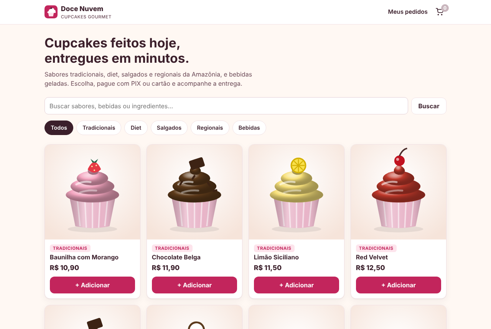

# 🧁 Doce Nuvem Cupcakes Gourmet

**Projeto Integrador Transdisciplinar em Engenharia de Software II** · Flavio Salomão Miranda · RGM 46724478

Loja virtual de cupcakes com vitrine, carrinho, embalagem presente, frete por CEP, pagamento por PIX ou cartão (simulado), acompanhamento do pedido e painel do lojista com alerta sonoro. É a construção do sistema planejado no **PIT I (Loja de Cupcakes Gourmet)**.



| | |
|---|---|
| Back-end | Python 3 + Flask, padrão **MVC** |
| Banco | SQLite 3 (script físico em `database/schema.sql`) |
| Front-end | HTML5, CSS3 e JavaScript puro, *mobile-first*, sem frameworks |
| Testes | **111 automatizados**: 61 unitários, 39 de integração, 9 de front-end e 2 de sistema no navegador; **93% de cobertura** |
| Modo | Codificação tradicional |
| Repositório | https://github.com/flaviosalomaomiranda/pit2-cupcakes-gourmet |
| Solução on-line | _link do Render, a preencher após o deploy_ |
| Vídeo | _link do vídeo, a preencher_ |

## Como rodar

**Windows:** instale o [Python 3.10+](https://www.python.org/downloads/) (marque *Add to PATH*) e dê dois cliques em `INICIAR.bat`.

```bash
pip install -r requirements.txt
python run.py            # http://127.0.0.1:5000  ·  painel: /admin  (admin / cupcake123)
python -m pytest tests   # testes
```

Detalhes em [Manual de uso](docs/02-situacao-2-desenvolvimento/02-manual-de-uso.md).

## Documentação (organizada por situação-problema)

**Situação 1: revisão do planejamento**
1. [Escopo revisado, histórias e o que mudou desde o PIT I](docs/01-situacao-1-planejamento/01-escopo-revisado.md)
2. [UML: casos de uso, caso expandido, classes, sequência, atividades, estados](docs/01-situacao-1-planejamento/02-uml.md)
3. [IHC: telas, mensagens de erro, mapa conceitual e navegacional](docs/01-situacao-1-planejamento/03-ihc.md)
4. [Banco: conceitual, lógico normalizado e físico](docs/01-situacao-1-planejamento/04-banco-de-dados.md)
5. [Dicionário de dados](docs/01-situacao-1-planejamento/05-dicionario-de-dados.md)

**Situação 2: desenvolvimento**
- [Arquitetura MVC, decisões, segurança e resiliência](docs/02-situacao-2-desenvolvimento/01-arquitetura.md)
- [Manual de uso e instalação](docs/02-situacao-2-desenvolvimento/02-manual-de-uso.md)

**Situação 3: testes e validação**
- [Plano de testes e laudo de qualidade](docs/03-situacao-3-testes-validacao/01-plano-e-laudo-de-testes.md)
- [Formulário de avaliação para os 5 testadores](docs/03-situacao-3-testes-validacao/02-formulario-avaliacao.md)
- [Resultado das avaliações e melhorias](docs/03-situacao-3-testes-validacao/03-resultado-avaliacoes.md)
- [Roteiro do vídeo](docs/03-situacao-3-testes-validacao/04-roteiro-video.md)

[Roadmap](docs/04-roadmap.md)

## Estrutura

```
app/controllers  → CONTROLLER (Blueprints Flask)
app/models       → MODEL (acesso a dados)
app/services     → MODEL (regras de negócio puras)
app/templates    → VIEW (HTML) · app/static → CSS/JS
database/        → schema.sql e seed.sql
tests/ tests_front/ tests_e2e/ → testes
docs/            → documentação
```

> Ambiente acadêmico: os pagamentos são simulados e nenhuma cobrança real é feita.
