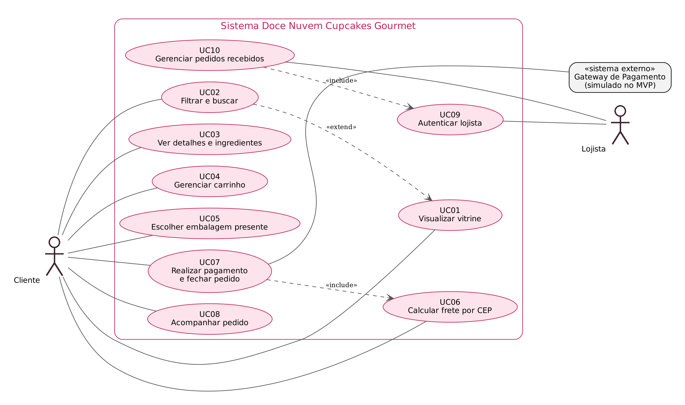
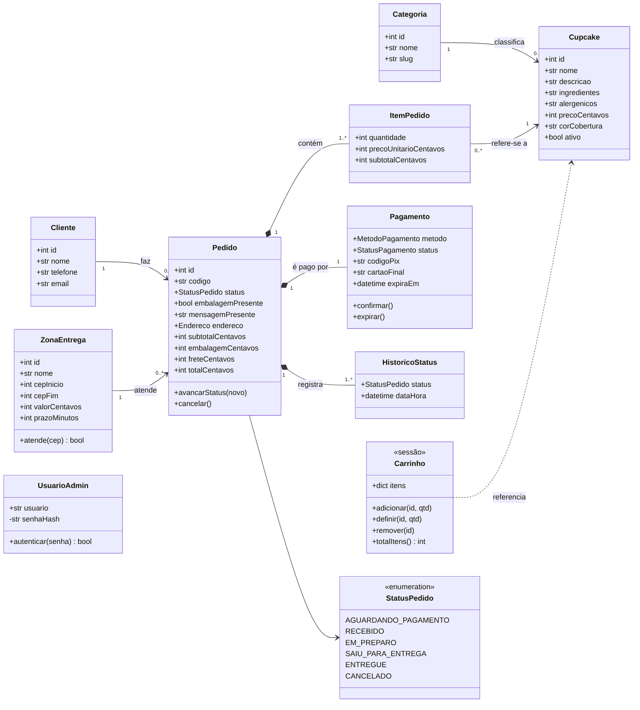
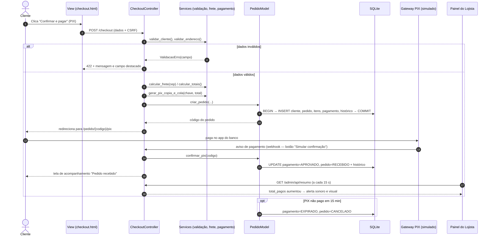
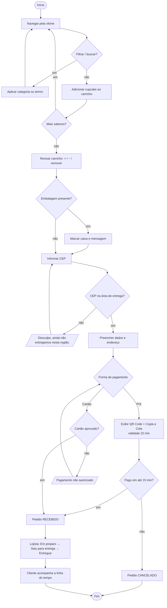
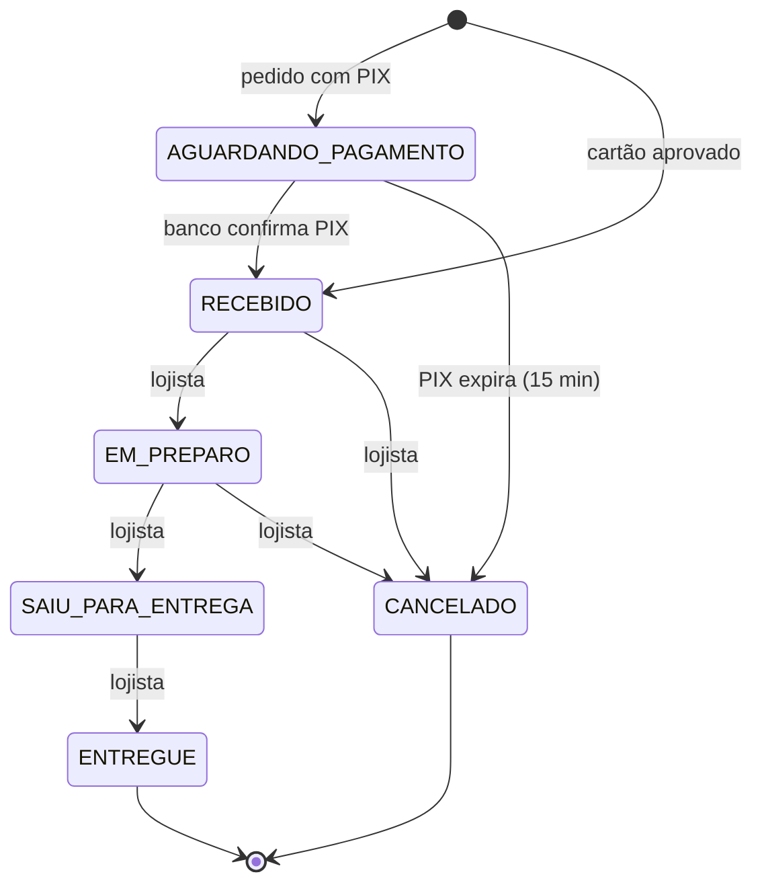
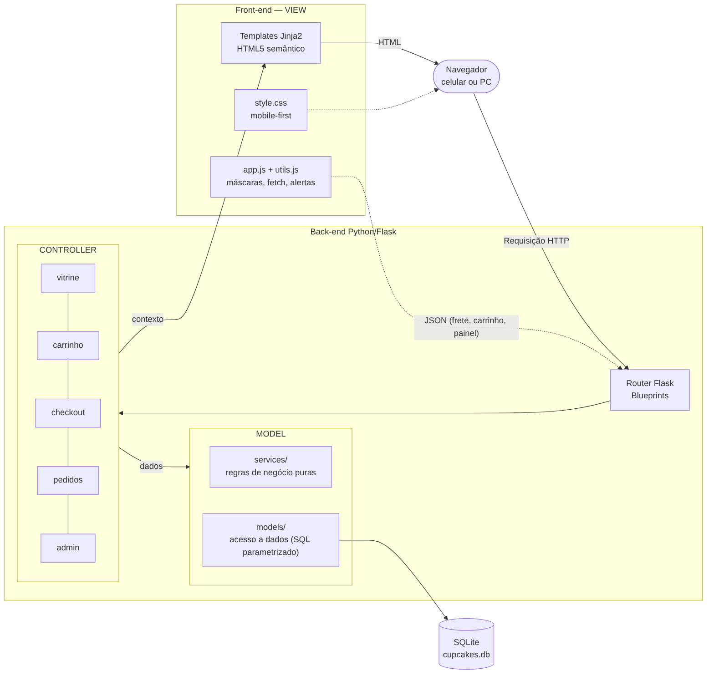

# 2. Modelagem UML revisada

Os diagramas-fonte estão em [`docs/diagramas/`](../diagramas): Mermaid (`.mmd`), que o GitHub desenha sozinho, e Graphviz (`.dot`). As imagens prontas ficam em `docs/img/uml/`.

## 2.1 Diagrama de casos de uso

**O que mudou desde o PIT I:** o caso "Calcular frete" passou a ser `«include»` de "Realizar pagamento", porque não se paga sem frete. Entraram "Filtrar e buscar" (`«extend»` da vitrine), "Escolher embalagem presente" e "Autenticar lojista".

## 2.2 Caso de uso expandido: UC07 Realizar pagamento e fechar pedido

| Campo | Descrição |
|---|---|
| Identificador | UC07 |
| Ator principal | Cliente |
| Ator secundário | Gateway de pagamento (simulado no MVP) |
| Pré-condições | Carrinho com pelo menos 1 item; CEP informado e dentro da área de entrega (RN-FRETE) |
| Pós-condições | Pedido gravado com itens, pagamento e histórico. Se aprovado, aparece no painel do lojista com status **Recebido**. |

**Fluxo principal (PIX)**

1. O cliente clica em **Ir para pagamento** no carrinho (TELA-04).
2. O sistema exibe a TELA-05 (Checkout) com o resumo: itens, embalagem, frete e total.
3. O cliente preenche nome, celular, e-mail e endereço, e escolhe **PIX**.
4. O sistema valida os dados (RN-VALIDA) <FA-A>.
5. O sistema grava o pedido numa única transação: cliente, pedido, itens, pagamento PENDENTE com validade de 15 min e histórico.
6. O sistema exibe a TELA-06 (PIX) com o QR Code, o código Copia e Cola e a contagem regressiva.
7. O cliente paga no app do banco.
8. O gateway avisa o pagamento. No MVP, isso é o botão "Simular confirmação do banco" <FA-C>.
9. O sistema marca o pagamento como APROVADO e o pedido como RECEBIDO, e registra o histórico.
10. O sistema mostra a TELA-07 (acompanhamento). O painel do lojista detecta o novo pedido em até 15 s e toca o alerta.

**Fluxos alternativos**

- **FA-A Dados inválidos (passo 4):** o sistema mostra a mensagem, destaca o campo (`aria-invalid`) e mantém o que foi digitado, exceto os dados de cartão. Volta ao passo 3.
- **FA-B Cartão (passo 3):** o cliente informa número, nome, validade e CVV. O sistema valida Luhn, validade e CVV e consulta o gateway.
  - B1: aprovado → o pedido já nasce RECEBIDO. Segue no passo 10.
  - B2: recusado → mensagem "Cartão recusado pelo emissor…" ou "Saldo insuficiente…". **Nenhum pedido é criado** e o cliente volta ao passo 3.
- **FA-C PIX expirado:** se o pagamento não chegar em 15 min, o sistema marca o PIX como EXPIRADO e o pedido como CANCELADO. A tela informa "o PIX não foi pago dentro de 15 minutos".
- **FA-D Carrinho vazio ou CEP fora da área:** o acesso ao checkout é negado e o cliente volta ao carrinho com a mensagem correspondente.

**Regras de negócio:** RN-FRETE (faixas de CEP, tabela `zona_entrega`); RN-PRECO (o preço vem sempre do banco, nunca do navegador); RN-LIMITE (máximo de 50 unidades por sabor); RN-PIX (validade de 15 min); RN-CARTAO (guarda só os 4 últimos dígitos); RN-STATUS (máquina de estados, ver 2.6).

## 2.3 Diagrama de classes (domínio/persistência)

## 2.4 Diagrama de sequência: UC07 com PIX

O diagrama mostra a separação MVC em ação: a View envia o formulário, o Controller orquestra, os Services aplicam as regras e o Model persiste numa transação.

## 2.5 Diagrama de atividades: jornada de compra

## 2.6 Máquina de estados do pedido

Implementada em `app/services/status.py` (`TRANSICOES`). Qualquer outra transição é recusada com mensagem. A atualização usa `UPDATE … WHERE status = <status atual>` (controle de concorrência otimista): se duas abas do painel agirem ao mesmo tempo, a segunda recebe "O pedido foi alterado por outra pessoa".

## 2.7 Diagrama de componentes (arquitetura MVC)

