# 3. IHC: interface humano-computador revisada

Os wireframes do PIT I (Vitrine, Carrinho e Checkout) viraram telas reais. As capturas abaixo foram geradas **automaticamente** pelo teste de sistema (`tests_e2e/`), num navegador real, com a tela de celular de 390 px e a de computador de 1280 px.

## 3.1 Princípios do material aplicados

| Princípio | Como aparece na interface |
|---|---|
| **Clara** | Um único botão de destaque por tela ("+ Adicionar", "Ir para pagamento", "Confirmar e pagar"); preço sempre visível. |
| **Consistente** | Os mesmos componentes em todo o site: pílulas de filtro, cards, caixas, botões primário e secundário. |
| **Simples** | Revelação progressiva: os campos do cartão só aparecem ao escolher "Cartão"; a mensagem do presente, só ao marcar a embalagem. |
| **Controlada pelo usuário** | Nada acontece sozinho, exceto o recarregamento da página de acompanhamento, que é avisado na tela. O cliente pode remover itens, trocar o CEP e voltar. |
| **Direta** | Ao clicar em "+ Adicionar", o contador do carrinho pula na hora (feedback de causa e efeito). |
| **Empática/reversível** | Erros não apagam o que foi digitado; cancelamento pelo lojista pede confirmação. |
| **Dá resposta** | Mensagens de sucesso e erro com `aria-live`; contagem regressiva do PIX; linha do tempo do pedido. |
| **Esteticamente agradável** | Paleta "confeitaria" (creme, framboesa, cacau), tipografia do sistema, ilustrações vetoriais por sabor. |

## 3.2 Telas

| Celular | |
|---|---|
| 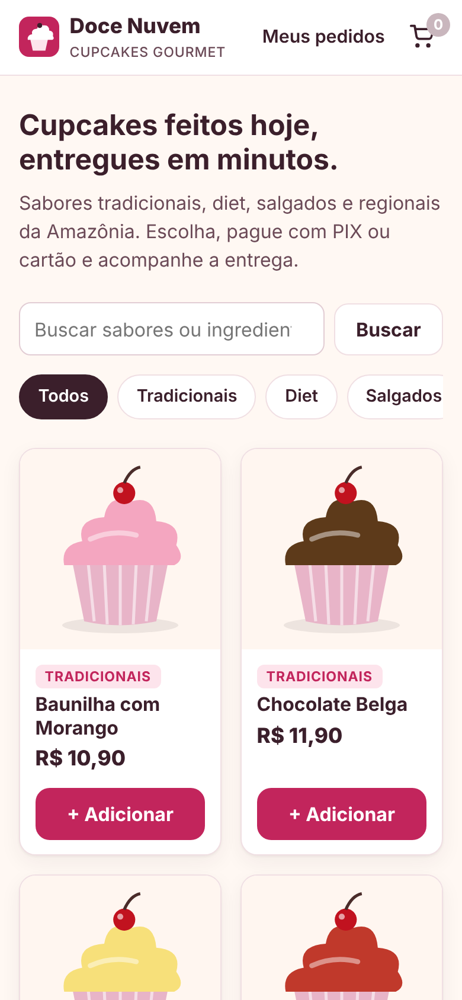 **TELA-01 Vitrine** | 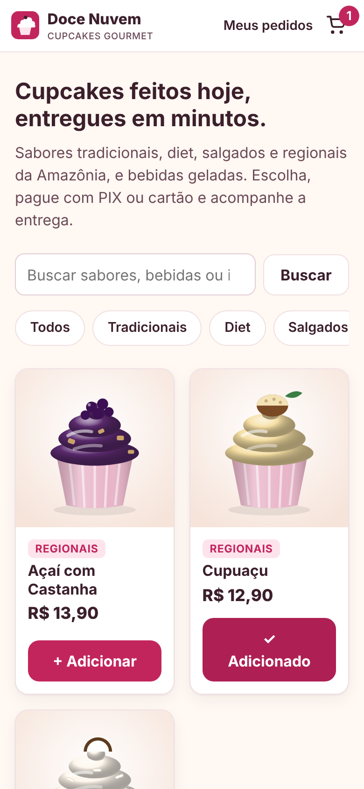 **TELA-01b Filtro "Regionais"** |
| 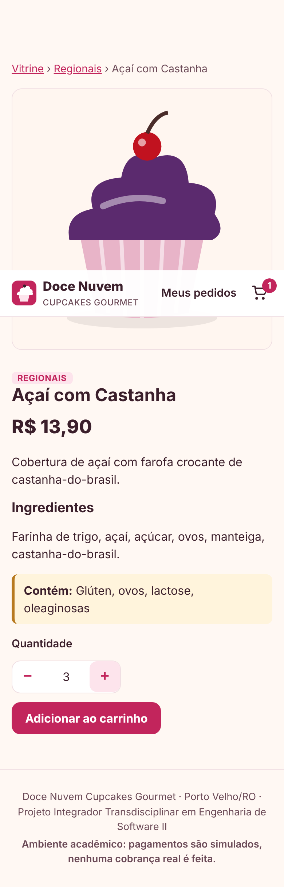 **TELA-02 Detalhe e ingredientes** | 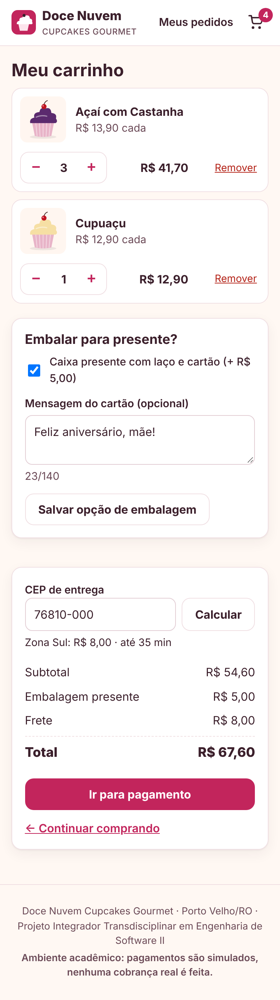 **TELA-03 Carrinho, presente e frete** |
| 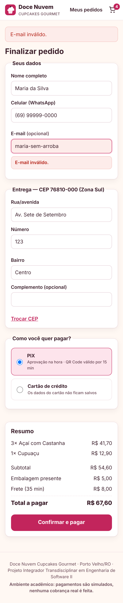 **TELA-04 Checkout com erro de validação** | 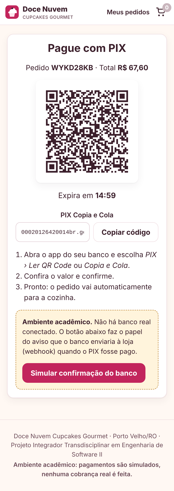 **TELA-05 PIX** |
| 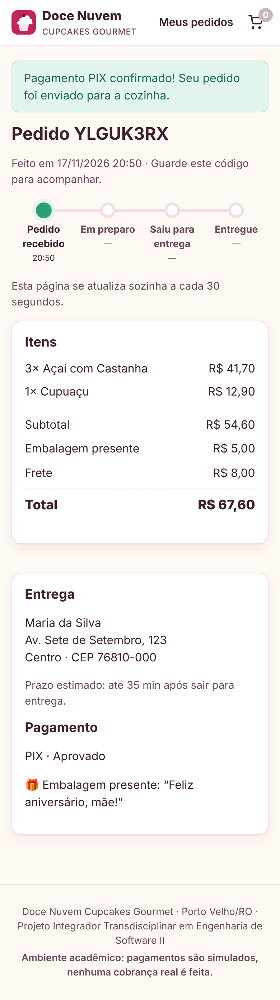 **TELA-06 Acompanhamento** | 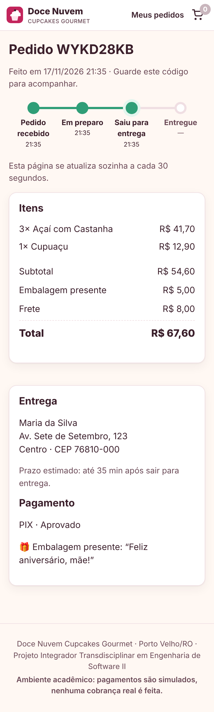 **TELA-06 Saiu para entrega** |

Computador:

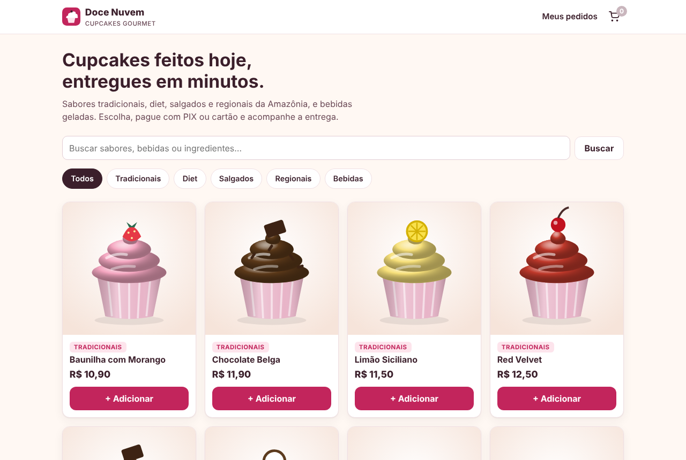
**TELA-01 Vitrine (desktop)**

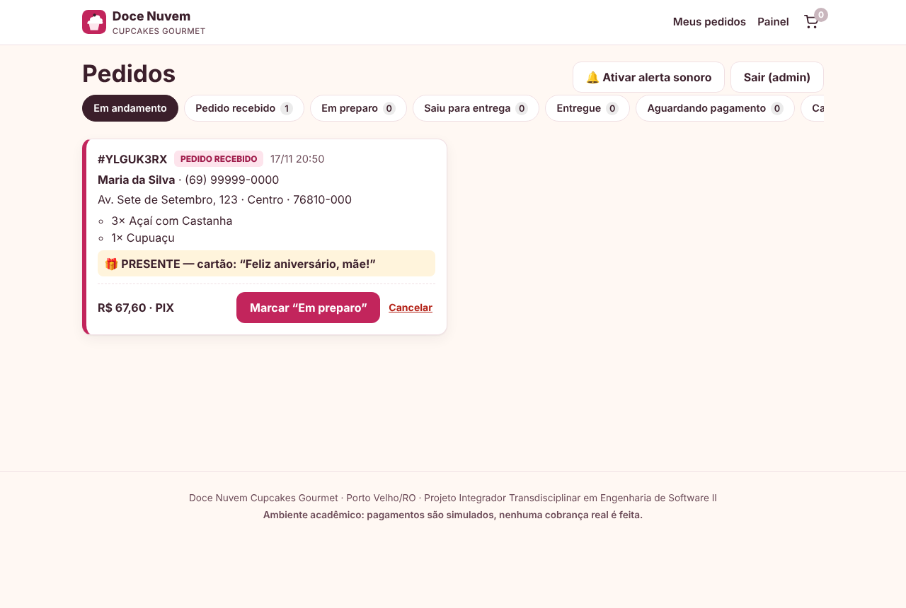
**TELA-08 Painel do lojista**

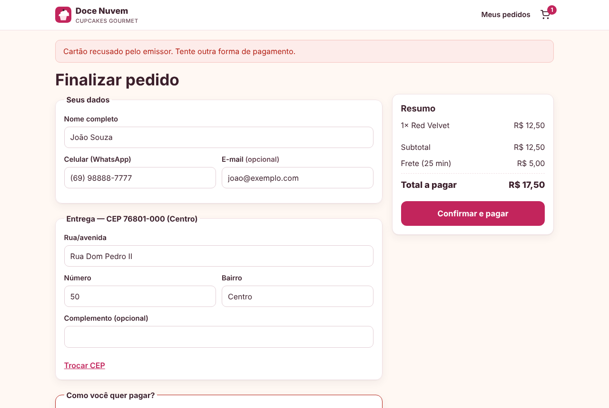
**TELA-04 Cartão recusado (fluxo alternativo)**

## 3.3 Catálogo de mensagens

| Situação | Mensagem exibida | Tipo |
|---|---|---|
| Item adicionado | "Red Velvet adicionado ao carrinho." / botão vira "✓ Adicionado" | Sucesso |
| Mais de 50 do mesmo sabor | "Limite de 50 unidades por sabor." | Erro |
| Carrinho vazio | "Seu carrinho está vazio." + botão "Ver cupcakes" | Informativa |
| CEP incompleto | "Informe um CEP válido com 8 números (ex.: 76801-000)." | Erro de campo |
| CEP fora da área | "Desculpe, ainda não entregamos nesta região." | Regra de negócio |
| Frete calculado | "Entregamos em 76810-000 (Zona Sul): R$ 8,00 — até 35 min." | Sucesso |
| Nome, telefone ou e-mail inválido | "Nome é obrigatório." / "Telefone deve ter DDD + número (10 ou 11 dígitos)." / "E-mail inválido." | Erro de campo (destacado) |
| Cartão inválido | "Número do cartão inválido." (já no navegador, pelo algoritmo de Luhn) | Erro de campo |
| Cartão vencido | "Cartão vencido." | Erro de campo |
| Cartão recusado | "Cartão recusado pelo emissor. Tente outra forma de pagamento." | Regra de negócio |
| PIX pago | "Pagamento PIX confirmado! Seu pedido foi enviado para a cozinha." | Sucesso |
| PIX expirado | "Pedido cancelado: o PIX não foi pago dentro de 15 minutos." | Informativa |
| Código de pedido errado | "Não encontramos um pedido com esse código. Confira as 8 letras/números." | Erro |
| Sessão expirada | "Sessão expirada ou formulário inválido. Recarregue a página e tente de novo." (400) | Erro |
| Página inexistente | "Página não encontrada" (404) com botão "Voltar à vitrine" | Erro |
| Falha inesperada | "Tivemos um problema inesperado. Seu carrinho foi preservado; tente novamente." (500) | Erro |
| Login errado | "Usuário ou senha incorretos." | Erro |
| 5 logins errados | "Muitas tentativas. Aguarde 5 minutos." (429) | Segurança |
| Status inválido | "Não é possível passar de 'Entregue' para 'Em preparo'." | Regra de negócio |

## 3.4 Mapa conceitual

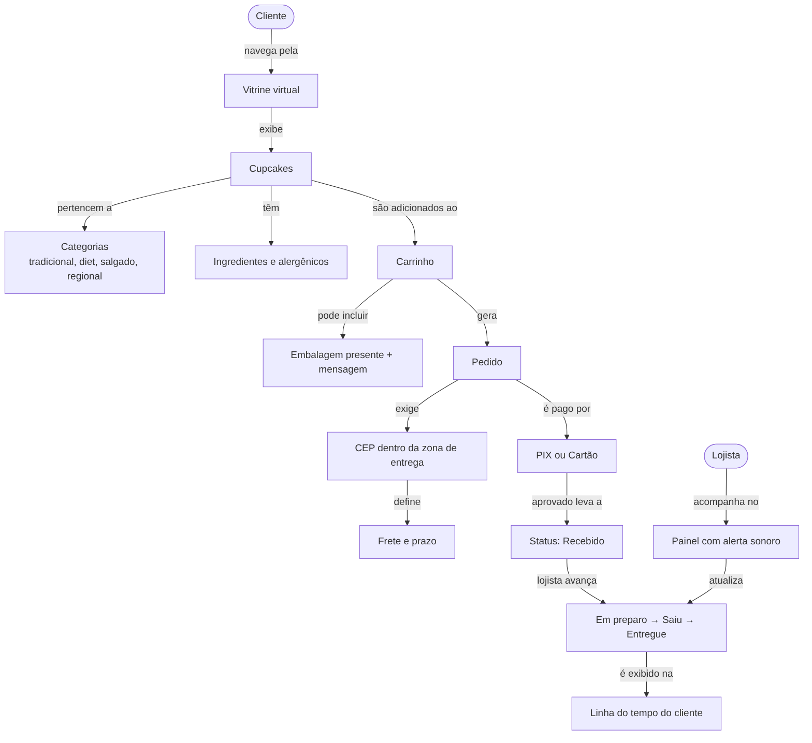

## 3.5 Mapa navegacional (mapa do app)

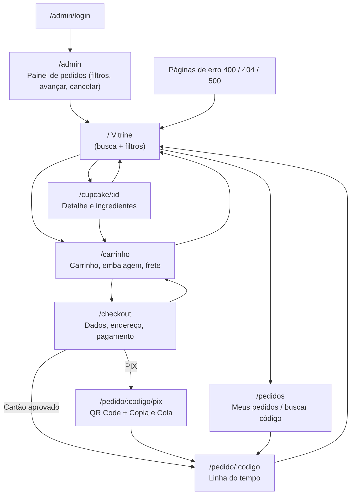

Não há telas sem saída: toda página tem o cabeçalho com a marca (volta à vitrine), "Meus pedidos" e o carrinho. As páginas de erro trazem o botão "Voltar à vitrine".

## 3.6 Acessibilidade e leveza

- Contraste AA nas cores de texto, foco visível em todos os elementos e link "Pular para o conteúdo".
- Campos com `autocomplete` e `inputmode` corretos (teclado numérico para CEP, cartão e telefone).
- Sem bibliotecas externas nem fontes da web: a página inicial completa pesa cerca de **35 KB**, então carrega rápido em celular simples.
- Respeita "reduzir movimento" do sistema operacional.
