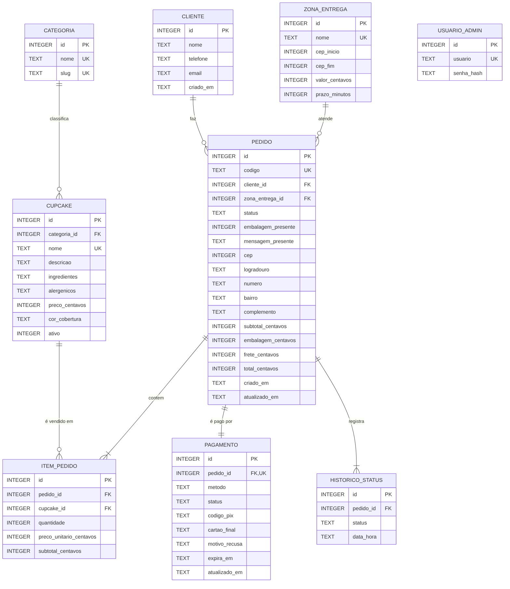

# 4. Projeto de banco de dados

**SGBD escolhido: SQLite 3.** É o banco de dados mais usado do mundo: está embutido no Python, no Android, no iOS e nos navegadores. Não precisa de servidor nem de instalação e guarda tudo num único arquivo, o que facilita a manutenção e a avaliação pelo tutor. Como todo o SQL segue o padrão ANSI (com `CHECK`, `FOREIGN KEY` e `UNIQUE`), a migração para PostgreSQL em produção é direta (ver Roadmap).

## 4.1 Projeto conceitual (DER)



Entidades e cardinalidades:

- **Categoria** 1 — N **Cupcake**
- **Cliente** 1 — N **Pedido**
- **ZonaEntrega** 1 — N **Pedido**
- **Pedido** 1 — N **ItemPedido** N — 1 **Cupcake** (o relacionamento N:N entre Pedido e Cupcake é resolvido pela entidade associativa ItemPedido)
- **Pedido** 1 — 1 **Pagamento**
- **Pedido** 1 — N **HistoricoStatus**
- **UsuarioAdmin** (isolada: controla o acesso ao painel)

## 4.2 Projeto lógico normalizado

```
CATEGORIA     (id, nome, slug)
CUPCAKE       (id, categoria_id→CATEGORIA, nome, descricao, ingredientes, alergenicos,
               preco_centavos, cor_cobertura, ativo)
ZONA_ENTREGA  (id, nome, cep_inicio, cep_fim, valor_centavos, prazo_minutos)
CLIENTE       (id, nome, telefone, email, criado_em)
PEDIDO        (id, codigo, cliente_id→CLIENTE, zona_entrega_id→ZONA_ENTREGA, status,
               embalagem_presente, mensagem_presente, cep, logradouro, numero, bairro, complemento,
               subtotal_centavos, embalagem_centavos, frete_centavos, total_centavos,
               criado_em, atualizado_em)
ITEM_PEDIDO   (id, pedido_id→PEDIDO, cupcake_id→CUPCAKE, quantidade,
               preco_unitario_centavos, subtotal_centavos)      UNIQUE(pedido_id, cupcake_id)
PAGAMENTO     (id, pedido_id→PEDIDO [UNIQUE], metodo, status, codigo_pix, cartao_final,
               motivo_recusa, expira_em, atualizado_em)
HISTORICO_STATUS (id, pedido_id→PEDIDO, status, data_hora)
USUARIO_ADMIN (id, usuario, senha_hash)
```

**Verificação das formas normais**

- **1FN:** todos os atributos são atômicos. Os itens do pedido, por exemplo, não ficam numa lista dentro de PEDIDO: estão na tabela ITEM_PEDIDO.
- **2FN:** todas as tabelas têm chave primária simples (`id`), então não há dependência parcial. Em ITEM_PEDIDO, a chave candidata composta `(pedido_id, cupcake_id)` determina todos os demais atributos.
- **3FN:** não há dependência transitiva entre atributos não chave. O nome da categoria está em CATEGORIA, e não repetido em CUPCAKE.

**Desnormalizações intencionais (documentadas):**

| Atributo | Por que existe |
|---|---|
| `item_pedido.preco_unitario_centavos` | Congela o preço da época da compra. Se o cardápio mudar, o pedido antigo não muda. |
| `pedido.logradouro…complemento` | Endereço histórico da entrega daquele pedido. |
| `pedido.subtotal/total` e `item_pedido.subtotal` | Totais calculados e guardados para relatórios rápidos. A consistência é garantida por `CHECK (total = subtotal + embalagem + frete)` e `CHECK (subtotal = quantidade × preço)`. |

## 4.3 Projeto físico

O script completo e comentado está em [`database/schema.sql`](../../database/schema.sql), com a carga inicial em [`database/seed.sql`](../../database/seed.sql): 4 categorias, 11 cupcakes e 4 zonas de entrega de Porto Velho.

Recursos de integridade usados:

| Recurso | Exemplos |
|---|---|
| `PRIMARY KEY AUTOINCREMENT` | todas as tabelas |
| `FOREIGN KEY … ON DELETE RESTRICT/CASCADE` | não se apaga categoria com cupcakes; itens são apagados junto com o pedido |
| `UNIQUE` | `pedido.codigo`, `cupcake.nome`, `pagamento.pedido_id` (garante o 1:1) |
| `CHECK` de domínio | `status IN (…)`, `metodo IN ('PIX','CARTAO')`, `quantidade BETWEEN 1 AND 50`, `preco BETWEEN 100 AND 100000`, formato da cor `#RRGGBB`, `cartao_final` com 4 dígitos |
| `CHECK` de regra de negócio | total do pedido = soma das partes; PIX exige `codigo_pix`; cartão proíbe `codigo_pix` |
| Índices | `ix_pedido_status` (filtros do painel), `ix_pedido_cliente`, `ix_cupcake_categoria`, `ix_historico_pedido` |

As restrições são **testadas**: `test_banco_rejeita_total_inconsistente` e `test_banco_rejeita_status_invalido_e_fk`.

**Como criar o banco manualmente:**

```bash
sqlite3 instance/cupcakes.db < database/schema.sql
sqlite3 instance/cupcakes.db < database/seed.sql
# ou, pela aplicação (também cria o usuário admin com senha em hash):
flask --app run init-db
```

Na primeira execução, a aplicação cria o banco sozinha se ele não existir.

## 4.4 Dicionário de dados

Ver [05-dicionario-de-dados.md](05-dicionario-de-dados.md), gerado a partir do schema real.
