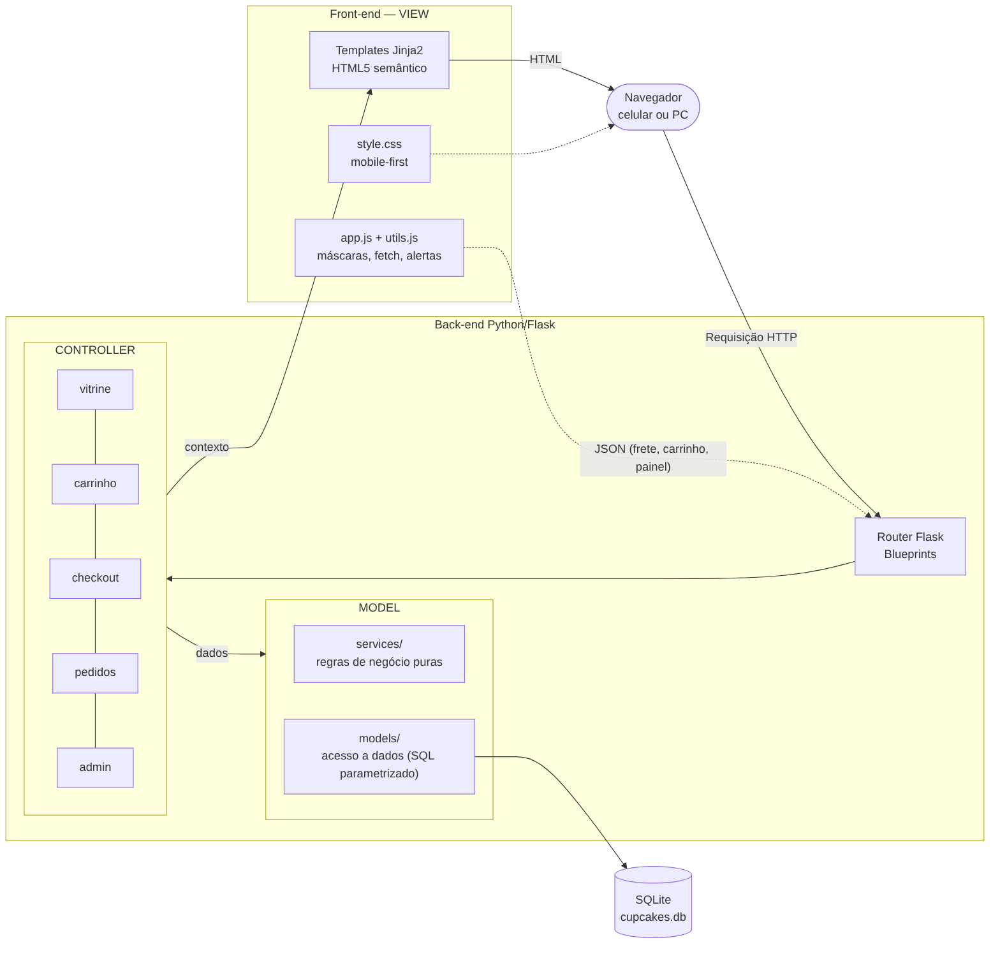

# Situação 2: arquitetura e codificação

## Tecnologias

| Camada | Tecnologia | Por quê |
|---|---|---|
| Linguagem do back-end | **Python 3.10+** | Uma das linguagens sugeridas; código legível e testável |
| Framework | **Flask 3** | Leve (≈1 MB), sem "mágica", ideal para mostrar o MVC explicitamente |
| Banco | **SQLite 3** | Popular, sem servidor, migrável para PostgreSQL |
| Front-end | **HTML5 + CSS3 + JavaScript puro** | Exatamente o pedido no material; sem frameworks, para rodar em máquinas modestas |
| QR Code PIX | `segno` | Biblioteca pura em Python, gera SVG leve |
| Testes | `pytest`, `node:test` (nativo do Node), Playwright | Unitário, integração e sistema |
| Modo de codificação | **Tradicional** | Todo o código foi escrito, não gerado em plataforma no-code |

## Padrão MVC aplicado



| Papel MVC | Pasta | Responsabilidade |
|---|---|---|
| **Model** | `app/models/` | Acesso a dados com SQL parametrizado e transações (`pedido.py`, `cupcake.py`, `zona.py`, `admin.py`) |
| **Model** (regras) | `app/services/` | Regras de negócio **puras**, sem banco nem HTTP: frete, carrinho, pagamento, validação, máquina de estados. Testáveis isoladamente. |
| **Controller** | `app/controllers/` | Blueprints Flask: recebem a requisição, chamam o Model e escolhem a View (`vitrine`, `carrinho`, `checkout`, `pedidos`, `admin`) |
| **View** | `app/templates/` + `app/static/` | HTML (Jinja2) com escape automático contra XSS, CSS e JS |
| Router | `app/__init__.py` | Registra os Blueprints, a segurança (CSRF, cabeçalhos) e as páginas de erro |

Fluxo de uma requisição, igual à Figura 2 do material: **Usuário → Requisição HTTP → Router → Controller ⇄ Model → View → HTML → Usuário**.

## Estrutura de pastas

```
pit2-cupcakes-gourmet/
├── app/
│   ├── __init__.py          # fábrica da aplicação, segurança, filtros, erros
│   ├── config.py            # configuração por variáveis de ambiente
│   ├── db.py                # conexão SQLite, criação do banco
│   ├── controllers/         # CONTROLLER
│   ├── models/              # MODEL (dados)
│   ├── services/            # MODEL (regras de negócio)
│   ├── templates/           # VIEW (HTML)
│   └── static/              # VIEW (CSS, JS, imagens)
├── database/schema.sql      # projeto físico
├── database/seed.sql        # carga inicial
├── tests/                   # unitários + integração (pytest)
├── tests_front/             # unitários do JavaScript (node:test)
├── tests_e2e/               # sistema/ponta a ponta (Playwright)
├── scripts/                 # gerador do dicionário de dados
├── docs/                    # documentação por situação-problema
├── INICIAR.bat              # abrir no Windows com dois cliques
└── run.py                   # ponto de entrada
```

## Decisões técnicas e trade-offs

| Decisão | Alternativa descartada | Motivo |
|---|---|---|
| Carrinho na sessão (cookie assinado), só com IDs e quantidades | Carrinho em tabela no banco | Sem login de cliente, a sessão basta. Os preços **sempre** vêm do banco, o que impede adulteração. |
| Imagens SVG geradas por sabor | Fotos JPG | Cerca de 1 KB contra 100 KB por imagem, nítidas em qualquer tela. A troca por fotos reais está no Roadmap. |
| Pagamento simulado com formato real | Integrar Mercado Pago/PagSeguro | O gateway exige CNPJ e credenciais. A interface `services/pagamento.py` deixa a troca localizada. |
| Polling a cada 15 s no painel | WebSocket | Mais simples, funciona em qualquer hospedagem e consome pouco. |
| Melhoria progressiva (funciona sem JS) | SPA em React | Mais leve e mais robusto. O material pede HTML, CSS e JS. |

## Tratamento de erros e resiliência

- Exceções de domínio (`ValidacaoErro`, `RegraNegocioErro`) viram mensagens amigáveis e destacam o campo com erro. Exceções inesperadas são registradas em log (`logging`) e mostram a página 500, que não perde o carrinho.
- A criação do pedido é **transacional**: em qualquer falha, tudo volta atrás (`rollback`).
- Confirmação de PIX **idempotente**: se o banco avisar duas vezes, nada duplica.
- **Concorrência otimista** na mudança de status.
- Expiração automática de PIX pendente após 15 min.
- Fallbacks no front: se o `fetch` falhar, o formulário é enviado do jeito tradicional; se a área de transferência não funcionar, usa `execCommand('copy')`.

## Segurança

| Ameaça | Proteção |
|---|---|
| CSRF | Token por sessão em todo POST (`_registrar_seguranca`) |
| XSS | Escape automático do Jinja2 e Content-Security-Policy `default-src 'self'` (sem scripts inline) |
| SQL Injection | 100% das consultas parametrizadas (`?`) |
| Clickjacking | `X-Frame-Options: DENY`, `frame-ancestors 'none'` |
| Senha do lojista | Hash do Werkzeug (scrypt/PBKDF2); sessão renovada no login (evita fixação de sessão) |
| Força bruta | Máximo de 5 tentativas a cada 5 min por IP |
| Dados de cartão | Nunca gravados; só os 4 últimos dígitos (há teste que procura o número no banco) |
| Adulteração de preço | O preço vem do banco; o carrinho do cookie é saneado |
| Segredos | `SECRET_KEY`, `ADMIN_SENHA` por variável de ambiente; sem chave fixa no código |
