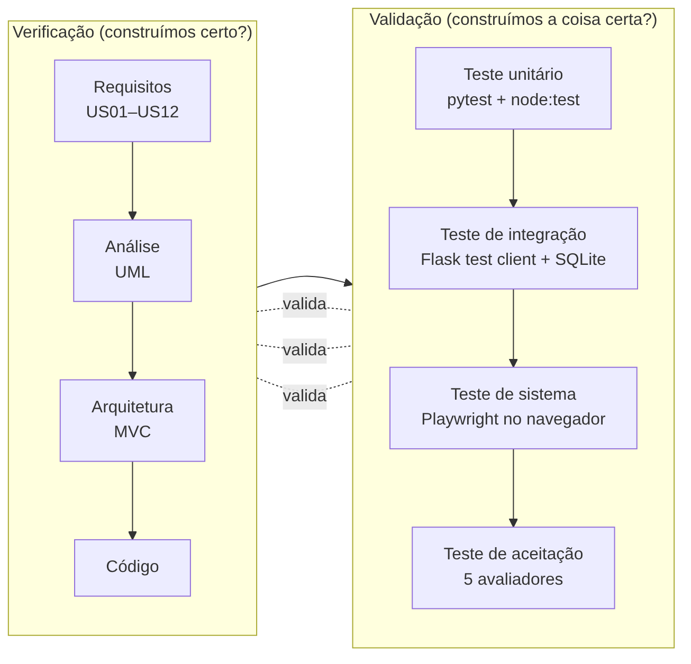

# Situação 3: plano de testes e laudo de qualidade

## 1. Estratégia (Modelo V)



| Nível | O que valida | Ferramenta | Arquivo | Qtde | Resultado |
|---|---|---|---|---|---|
| Unitário (back-end) | Regras de negócio isoladas: frete, carrinho, pagamento, PIX, validação, status | pytest | `tests/test_unit_servicos.py` | 61 | ✅ 61/61 |
| Unitário (front-end) | Máscaras, Luhn, quantidade, moeda, contagem do PIX | node:test (nativo) | `tests_front/utils.test.js` | 9 | ✅ 9/9 |
| Integração | Controller + Model + SQLite real, um teste por história de usuário | pytest + Flask test client | `tests/test_integracao.py` | 39 | ✅ 39/39 |
| Sistema (ponta a ponta) | Jornada completa no navegador real, celular e desktop, cliente e lojista, sem erro de JavaScript | Playwright (Chromium) | `tests_e2e/test_sistema_navegador.py` | 2 roteiros (≈60 verificações) | ✅ 2/2 |
| Aceitação | Uso real por 5 pessoas | Formulário de avaliação | `02-formulario-avaliacao.md` | 5 | ⏳ ver seção 6 |

**Total automatizado (v1.1): 121 testes, 100% aprovados (109 pytest + 10 front-end + 2 de sistema). Cobertura de código do back-end: 93%** (relatório completo em `evidencias/pytest-unitarios-integracao.txt`).

Como reproduzir:

```bash
python -m pytest tests -v --cov=app      # unitários + integração + cobertura
node --test tests_front/utils.test.js    # front-end
python -m pytest tests_e2e -v            # sistema (gera as capturas em docs/img/telas)
```

## 2. Verificação × Validação

- **Verificação** ("construímos certo?"): revisão do código contra a UML e o schema; testes unitários e de integração; restrições do banco testadas; checagem de que nenhum dado de cartão é gravado.
- **Validação** ("construímos o que o cliente precisa?"): cada critério de aceite das US01–US12 tem teste de integração correspondente (matriz abaixo); teste de sistema executando a jornada do cliente e do lojista; avaliação por 5 pessoas.

## 3. Matriz de rastreabilidade (requisito → teste)

| Requisito | Testes |
|---|---|
| US01 Vitrine | `test_us01_vitrine_lista_todos_os_cupcakes_com_preco`, `test_imagem_svg_do_cupcake`, E2E passo 1 |
| US02/US12 Filtro e busca | `test_us02_filtro_por_categoria`, `test_us02_busca_por_ingrediente`, `test_us02_busca_sem_resultado_mostra_mensagem`, `test_us02_categoria_invalida_vira_todos`, E2E passo 2 |
| US03 Ingredientes | `test_us03_detalhe_mostra_ingredientes_e_alergenicos`, `test_detalhe_inexistente_retorna_404_amigavel` |
| US04 Carrinho | `test_us04_*` (5 testes), `test_carrinho_*` (6 unitários), E2E passos 2–4 |
| US05 Presente | `test_us05_embalagem_presente_soma_ao_total`, `test_mensagem_presente_limite` |
| US06 Total | `test_calcular_totais_*`, `test_banco_rejeita_total_inconsistente`, `test_preco_vem_do_banco_e_nao_do_navegador` |
| US07 Pagamento | `test_uc04_cartao_aprovado_cria_pedido_recebido`, `test_uc04_cartao_recusado_nao_cria_pedido`, `test_uc04_cartao_nunca_e_salvo_completo`, `test_uc04_pix_fluxo_completo`, `test_uc04_pix_expira_em_15_min_e_cancela`, `test_luhn`, `test_validar_cartao_*`, `test_pix_copia_e_cola_estrutura_e_crc`, `test_crc16_vetor_de_referencia` |
| US08 Frete | `test_us08_*` (3), `test_normalizar_cep_*`, `test_calcular_frete_*` |
| US09 Acompanhar | `test_us09_acompanhar_por_codigo`, `test_us10_lojista_avanca_status_ate_entregue` |
| US10/US11 Painel | `test_us10_*` (6), E2E passo 7 |
| RNF04 Segurança | `test_post_sem_csrf_e_rejeitado`, `test_cabecalhos_de_seguranca`, `test_xss_na_busca_e_escapado`, `test_sql_injection_na_busca_nao_quebra`, `test_us10_bloqueio_apos_5_tentativas` |
| RNF05 Integridade | `test_banco_rejeita_*`, idempotência do PIX, `test_us10_concorrencia_status_desatualizado` |

## 4. Casos de teste de destaque (entrada → esperado → obtido)

| ID | Cenário | Entrada | Resultado esperado | Obtido |
|---|---|---|---|---|
| CT01 | Frete dentro da área | CEP 76810-000 | Zona Sul, R$ 8,00, 35 min | ✅ igual |
| CT02 | Frete fora da área | CEP 01001-000 | "Desculpe, ainda não entregamos nesta região." e sem botão de pagar | ✅ igual |
| CT03 | Limite por sabor | 50 + 1 unidades | "Limite de 50 unidades por sabor." | ✅ igual |
| CT04 | Total do pedido | 2× Red Velvet + 1× Queijo e Ervas, Centro | 2×12,50 + 9,90 + 5,00 = **R$ 39,90** no banco | ✅ 3990 centavos |
| CT05 | Cartão aprovado | 4111 1111 1111 1111, 12/35, 123 | Pedido RECEBIDO; banco guarda só "1111" | ✅ igual |
| CT06 | Cartão recusado | 4000 0000 0000 0002 | Mensagem de recusa; **0 pedidos** no banco; dados digitados preservados | ✅ igual |
| CT07 | PIX pago | confirmar dentro do prazo | AGUARDANDO_PAGAMENTO → RECEBIDO; confirmar 2× não duplica | ✅ igual |
| CT08 | PIX expirado | expira_em no passado | Pedido CANCELADO; confirmação recusada | ✅ igual |
| CT09 | Status fora de ordem | Cancelado → avançar | "Não é possível passar de 'Cancelado' para…" | ✅ igual |
| CT10 | Ataque CSRF | POST sem token | HTTP 400 | ✅ igual |
| CT11 | XSS na busca | `<script>alert(1)</script>` | Texto escapado, não executa | ✅ igual |
| CT12 | Força bruta no login | 6 tentativas | HTTP 429 na 6ª | ✅ igual |

## 5. Laudo de qualidade: defeitos encontrados e corrigidos

| ID | Encontrado por | Defeito | Causa raiz | Correção | Prevenção |
|---|---|---|---|---|---|
| **DEF-01** | Teste de integração `test_uc04_cartao_aprovado_cria_pedido_recebido` (falhou na 1ª execução) | Pagar com cartão sempre dava "Número deve ter no máximo 10 caracteres." | O campo do número do cartão e o campo "Número" do endereço tinham o **mesmo nome** (`numero`) no formulário; o servidor lia o número do cartão como número da casa | Campo do cartão renomeado para `numero_cartao` em template, controller e validação | O teste de integração do fluxo de cartão passou a cobrir o formulário completo |
| **DEF-02** | Revisão das capturas do teste de sistema | Telefone do cliente aparecia sem formatação no painel (`69999990000`), difícil de ler para o lojista | O banco guarda só dígitos (correto), mas faltava formatar na View | Filtro `telefone` no Jinja: `(69) 99999-0000` | Regra: formatação sempre na View, dado bruto no Model |
| **DEF-03** | Revisão de código durante o desenvolvimento | Ao adicionar itens pela vitrine com JavaScript, as mensagens "adicionado ao carrinho" se acumulavam e apareciam todas juntas na página seguinte | A requisição via `fetch` gravava mensagens flash que ninguém exibia | Para requisições via JS, o servidor responde JSON (`total_itens`) sem mensagem flash; o contador usa o total real do servidor | Teste `test_us04_adicionar_via_javascript_retorna_json` |

| **DEF-04** | Instalação real no Windows do autor | O servidor não iniciava: `ZoneInfoNotFoundError: America/Porto_Velho` | O Windows não traz a base de fusos horários (no Linux, onde rodam os testes automatizados, ela existe) | Pacote `tzdata` nas dependências + reserva UTC−4 | Lição registrada: testar a instalação no sistema operacional do usuário, não só no ambiente de CI |
| **DEF-05** | Avaliador Luiz Cláudio | CEP 76800-000 (geral de Porto Velho) era recusado | Faixa da zona Centro começava em 76800-001 | Migração 002 corrige a faixa; mensagem informa os CEPs atendidos | `test_v11_cep_geral_de_porto_velho_e_aceito` |
| **DEF-06** | Avaliadora Nataska Wanssa | Busca anterior continuava aplicada ao trocar de categoria | Links das categorias repassavam o termo de busca | Categorias limpam a busca; link "Limpar busca" | `test_v11_trocar_categoria_limpa_a_busca` |
| **DEF-07** | Avaliador Leonardo Gobbi (usabilidade/estética) | Imagens pouco atrativas | Ilustrações planas e repetidas | Ilustrações com volume e enfeite por sabor; fotos reais no Roadmap | captura da vitrine v1.1 |
| **DEF-08** | Avaliador Fernando Miranda | Não conseguia pagar com cartão | Máscara da validade limitada a 4 dígitos: 12/2030 virava 12/20 (vencido); a mensagem de erro ficava só no topo da página | Máscara MM/AA ou MM/AAAA; mensagem de erro ao lado do campo, com `role=alert` | testes de front e de integração específicos |
| **DEF-09** | Avaliador Fernando Miranda (usabilidade) | E-mail obrigatório sem necessidade | Requisito excessivo no PIT I | E-mail opcional (migração 003 recria a tabela preservando dados) | `test_v11_email_e_opcional` |
| **DEF-10** | Prints da avaliadora Valdirene Aquino Demetrio | No celular, o topo ocupava 3 linhas e o texto da página aparecia por trás dele | Fundo do topo 96% opaco e textos quebrando em telas estreitas | Topo opaco, textos sem quebra e tamanhos menores abaixo de 420 px | captura do teste de sistema no celular |

**Situação atual:** nenhum defeito conhecido em aberto nos testes automatizados. Os defeitos relatados pelos avaliadores entram na seção 6.

**Limitações conhecidas (não são defeitos; estão no Roadmap):** pagamento simulado (sem gateway real); sem cadastro de cliente; no plano gratuito de hospedagem, o banco SQLite é reiniciado quando o servidor reinicia.

## 6. Validação com usuários (5 avaliadores)

Formulário em [`02-formulario-avaliacao.md`](02-formulario-avaliacao.md). Os resultados e as melhorias adotadas estão em [`03-resultado-avaliacoes.md`](03-resultado-avaliacoes.md).

## 7. Evidências

- `evidencias/pytest-unitarios-integracao.txt`: saída completa dos 100 testes e da cobertura
- `evidencias/node-test-front.txt`: saída dos 9 testes de front-end
- `evidencias/playwright-sistema.txt`: saída dos testes de sistema
- `docs/img/telas/*.png`: 15 capturas geradas pelo teste de sistema
